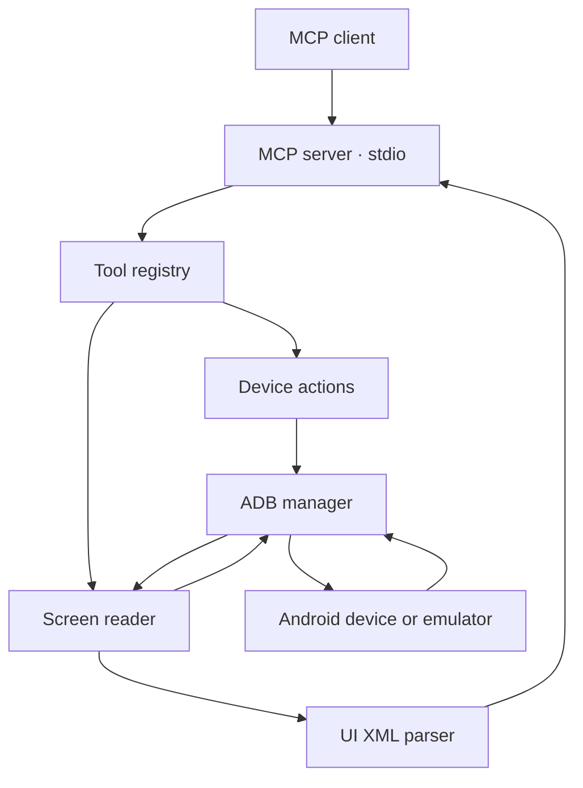

<div align="center">


### Give your AI agent eyes and hands on Android.

A headless Model Context Protocol server for reading Android screens, interacting with apps, and inspecting device state through ADB.

<br />


<br /><br />

[Overview](#overview) · [Tools](#tools) · [Architecture](#architecture) · [Getting Started](#getting-started) · [Client Configuration](#client-configuration) · [Examples](#examples)

</div>

<br />

## Overview

Droid MCP connects an MCP-compatible AI client to an Android device or emulator.

It exposes tools that let an agent inspect the current interface, tap controls, enter text, navigate between apps, and retrieve device information. Device communication uses Android Debug Bridge through `pure-python-adb`.

Screen reading uses UI Automator XML, which is converted into structured data containing relevant interface elements and their bounds.

The server runs headlessly. A separate desktop linker is included to help configure supported clients.

<br />

## Capabilities

| Area | What the agent can do |
| :--- | :--- |
| **Screen understanding** | Read interface text, descriptions, interactive elements, and coordinates |
| **Interaction** | Tap, long-press, swipe, and type into focused fields |
| **Navigation** | Press navigation buttons, launch apps, and open URLs |
| **Device inspection** | Retrieve device information, state, and crash logs |
| **System actions** | Request network changes and execute ADB shell commands |
| **Workflow timing** | Pause between actions when an interface needs time to update |

<br />

## Tools

### Screen & input

| Tool | Description |
| :--- | :--- |
| `read_current_screen` | Parse the UI Automator hierarchy into structured screen data |
| `tap_screen` | Tap a specific X/Y coordinate |
| `long_press_screen` | Long-press a coordinate |
| `swipe_screen` | Swipe between two coordinates with an optional duration |
| `type_text` | Enter text into the currently focused field |
| `press_button` | Press `home`, `back`, or `enter` |

### Apps & navigation

| Tool | Description |
| :--- | :--- |
| `open_application` | Launch an application by package name |
| `open_url` | Open a URL on the device |

### Inspection & system actions

| Tool | Description |
| :--- | :--- |
| `get_android_device_info` | Retrieve device details such as model, OS version, and battery information |
| `get_device_state` | Inspect device state |
| `get_crash_logs` | Retrieve recent crash information from logcat |
| `manage_network` | Request changes to Wi-Fi, mobile data, or airplane mode |
| `execute_adb_shell` | Execute a shell command on the connected device |
| `wait` | Pause for a specified duration |

Network and system actions depend on the permissions and restrictions of the Android device.

<br />

## Architecture

The implementation separates tool definitions, result models, Android communication, and MCP transport.



| Layer | Responsibility |
| :--- | :--- |
| **Core** | Shared tool abstraction and Pydantic result models |
| **Infrastructure** | ADB connection management and UI XML parsing |
| **Tools** | Screen reading, input, navigation, and device inspection |
| **Server** | MCP tool discovery, execution, and response formatting |
| **Desktop linker** | Client configuration through a Tkinter interface |

### Screen parsing

The parser extracts useful fields from UI Automator nodes:

- Text and content descriptions.
- Element class names.
- Clickable state.
- Screen bounds.
- Generated element identifiers.

It filters empty or non-interactive structural nodes to reduce the amount of screen data returned to the agent.

### Coordinate-based interaction

For an element with bounds:

```text
[x1, y1, x2, y2]
```

The agent can calculate the center:

```text
x = (x1 + x2) / 2
y = (y1 + y2) / 2
```

It then calls `tap_screen` using integer coordinates.

<br />

## Tech Stack

| Technology | Purpose |
| :--- | :--- |
| **Python** | Server and tool implementation |
| **MCP Python SDK** | Protocol handling and stdio transport |
| **Pydantic** | Data models |
| **pure-python-adb** | Communication with the local ADB server |
| **UI Automator** | Android UI hierarchy extraction |
| **Tkinter** | Optional desktop linker |
| **Pillow** | Desktop linker graphics |
| **Ruff / mypy** | Development tools listed in the requirements |

<br />

## Getting Started

### Prerequisites

- Python 3.11 or newer.
- Android SDK Platform Tools, including `adb`.
- An Android device with USB debugging enabled, or a running emulator.
- An MCP-compatible client.

### 1. Clone the repository

```bash
git clone https://github.com/ayoub-essarghini/droid-mcp.git
cd droid-mcp
```

### 2. Create a virtual environment

**macOS / Linux**

```bash
python3 -m venv .venv
source .venv/bin/activate
```

**Windows PowerShell**

```powershell
python -m venv .venv
.\.venv\Scripts\Activate.ps1
```

### 3. Install dependencies

```bash
python -m pip install -r requirements.txt
```

For the optional desktop linker, also install Pillow:

```bash
python -m pip install Pillow
```

Pillow is imported by `link_gui.py` but is not currently included in `requirements.txt`.

### 4. Connect Android

For a physical device:

1. Enable Developer Options.
2. Enable USB debugging.
3. Connect the device.
4. Accept the debugging authorization prompt.

For an emulator, start it before connecting the MCP client.

Check the connection:

```bash
adb start-server
adb devices
```

The target should appear with the status `device`.

The current server selects the first device returned by ADB.

### 5. Connect your MCP client

Use the configuration below, or the optional desktop linker.

<br />

## Client Configuration

The server communicates over **stdio**. The MCP client starts the Python process.

Use absolute paths to your virtual environment's interpreter and the repository.

### macOS / Linux example

```json
{
  "mcpServers": {
    "droid-mcp": {
      "command": "/absolute/path/to/droid-mcp/.venv/bin/python",
      "args": [
        "-m",
        "src.server.mcp_server"
      ],
      "env": {
        "PYTHONPATH": "/absolute/path/to/droid-mcp",
        "PYTHONUNBUFFERED": "1"
      }
    }
  }
}
```

### Windows example

```json
{
  "mcpServers": {
    "droid-mcp": {
      "command": "C:\\absolute\\path\\to\\droid-mcp\\.venv\\Scripts\\python.exe",
      "args": [
        "-m",
        "src.server.mcp_server"
      ],
      "env": {
        "PYTHONPATH": "C:\\absolute\\path\\to\\droid-mcp",
        "PYTHONUNBUFFERED": "1"
      }
    }
  }
}
```

The configuration wrapper and location depend on your client. These examples use the `mcpServers` format.

Restart or reload the client after adding the server.

<br />

## Optional Desktop Linker

The repository includes a Tkinter interface:

```bash
python link_gui.py
```

It provides separate actions for **VS Code / Cline** and **Claude Code**.

### Current behavior

| Client | Linker behavior |
| :--- | :--- |
| **Cline** | Configures a packaged server executable expected under `dist/` when running from source |
| **Claude Code** | Configures a Python module command with the project's `PYTHONPATH` |

The Cline linker supports configuration paths for macOS and Windows. Its automatic configuration does not currently support Linux.

For a source checkout without a packaged executable, use the manual configuration.

The Claude Code linker searches for a `venv/` interpreter or falls back to Python on `PATH`. If using `.venv/`, confirm that the generated command points to the intended interpreter.

### Tkinter on macOS

For Homebrew Python 3.11:

```bash
brew install python-tk@3.11
```

Match the Tkinter package to your Python version.

<br />

## Examples

### Inspect the device

> Check the connected Android device's model, OS version, and battery level.

### Read the interface

> Read the current screen and list the visible text and interactive controls.

### Open an application

> Open the Settings app and read the current screen.

### Interact with a control

> Read the screen, find the Settings icon, calculate the center of its bounds, and tap it.

### Enter text

> Find the search field, tap it to focus, and type “Android”.

### Investigate a crash

> Retrieve recent crash logs and summarize the reported error.

### Verify an interaction

> Read the screen, open an app, wait briefly, then read the screen again to check what changed.

<br />

## Project Structure

| Path | Responsibility |
| :--- | :--- |
| `src/main.py` | Server entry point |
| `src/core/base_tool.py` | Shared Android tool abstraction |
| `src/core/models.py` | Result and status models |
| `src/infrastructure/adb_manager.py` | Device connection and ADB commands |
| `src/infrastructure/ui_parser.py` | UI hierarchy parsing |
| `src/server/mcp_server.py` | MCP server and tool dispatch |
| `src/tools/read_screen.py` | Current screen reading |
| `src/tools/device_actions.py` | Input, navigation, and system actions |
| `src/tools/device_info.py` | Device information |
| `src/tools/__init__.py` | Registered tools |
| `link_gui.py` | Optional desktop linker |
| `requirements.txt` | Python dependencies |
| `ruff.toml` | Ruff configuration |

<br />

## Troubleshooting

| Problem | What to check |
| :--- | :--- |
| **No device connected** | Start ADB and confirm that `adb devices` lists a target |
| **Device is unauthorized** | Unlock the phone and accept the USB debugging prompt |
| **Wrong device selected** | The server currently uses the first ADB device; disconnect other targets |
| **Python cannot import `src`** | Set `PYTHONPATH` to the repository's absolute path |
| **Missing Python packages** | Check that the client uses the interpreter where dependencies were installed |
| **Linker cannot import `PIL`** | Install Pillow in the linker's Python environment |
| **Linker cannot import Tkinter** | Install Tkinter for the Python version being used |
| **Cline linker reports a missing executable** | Use manual source configuration or supply the expected packaged executable |
| **A system action fails** | Check Android version, device policy, and shell permissions |

<br />

## Current Scope

- One device is selected automatically from the local ADB server.
- Screen reading uses the UI hierarchy; screenshot-based vision and OCR are not implemented.
- The server uses stdio transport.
- Android permissions can restrict system and network actions.
- The GUI linker is separate from the headless server.
- The repository does not currently include an automated test suite.

Use a development device or emulator for automation. Tools can interact with apps, change settings, and execute shell commands.

<br />

## Possible Improvements

- Explicit device selection by serial number.
- More robust reconnect behavior.
- Additional input validation and shell escaping.
- Automated tests for parsing and tool execution.
- Screenshot capture for visual workflows.
- A source-based Cline linker.
- Unified dependency and packaging setup.

<br />

## License

Licensed under the [MIT License](LICENSE).

<br />

---

<div align="center">

**Built by [Ayoub Es Sarghini](https://github.com/ayoub-essarghini)**

[Portfolio](https://www.ayoub-essarghini.com/) · [LinkedIn](https://www.linkedin.com/in/ayoub-es-sarghini-839973212)


</div>
